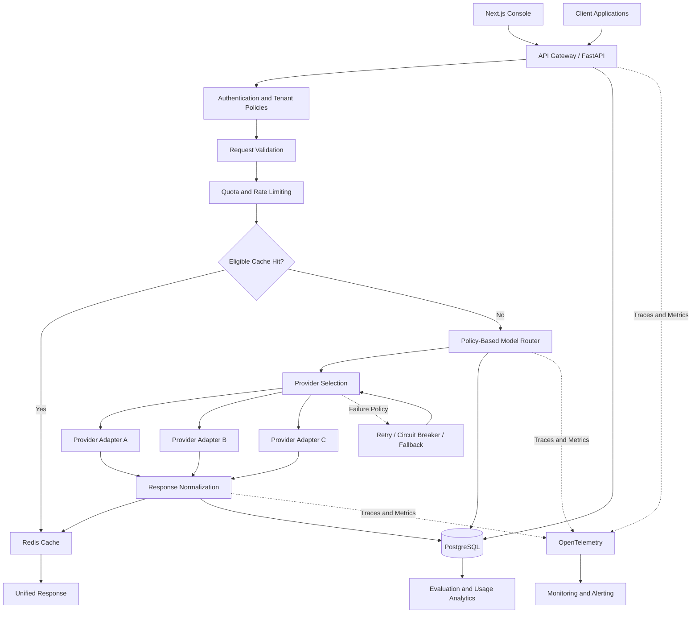

# ModelMesh AI — Enterprise LLM Gateway & LLMOps Platform

**A unified, production-oriented AI infrastructure platform for model routing, cost optimization, reliability, observability, and evaluation across multiple LLM providers.**


## Overview

ModelMesh AI is an enterprise LLM gateway and operations platform that provides a unified interface for integrating, managing, evaluating, and monitoring multiple large language model providers.

Instead of requiring every application team to implement provider integrations, retries, rate limiting, cost tracking, and observability independently, ModelMesh AI centralizes these capabilities behind a consistent API.

Applications submit inference requests to the gateway. The platform applies policies, selects an appropriate model, executes the request, and records operational metrics. When a provider becomes unavailable or a request fails, configurable fallback policies help maintain service reliability.

The platform is designed to address a central engineering challenge: **how do you make LLM integration reliable, cost-effective, observable, and consistent across an organization?**

ModelMesh AI is intended to evolve from a local development environment into a scalable, multi-tenant AI infrastructure service.

The repository is split into two independently built applications:

- **[`backend/`](backend/)** — Python / FastAPI gateway: provider adapters, routing, resilience, usage accounting, evaluation, and the public API.
- **[`frontend/`](frontend/)** — Next.js / TypeScript console: usage and cost dashboards, provider health, routing-policy and prompt management, and evaluation results.

## Key Features

### Unified Model Gateway
- A consistent API for multiple LLM providers.
- Provider-specific adapters behind a common interface.
- Support for chat completions, structured outputs, and streaming where supported.
- Centralized authentication, request validation, and error normalization.

### Intelligent Model Routing
- Route requests based on task type, configured quality requirements, cost, and latency.
- Support explicit model selection and policy-based automatic routing.
- Configure provider priorities and fallback chains.
- Track routing decisions and their outcomes.

### Reliability and Fault Tolerance
- Configurable timeouts and bounded retries.
- Circuit breakers for unhealthy providers.
- Fallback routing when eligible requests fail.
- Concurrency limits and backpressure.
- Request IDs and idempotency controls where applicable.

### Cost Management
- Track token consumption and estimated inference costs.
- Apply per-tenant budgets and usage quotas.
- Enforce request and token rate limits.
- Identify expensive models, tenants, and workloads.
- Support cost-aware model selection.

### Caching
- Cache eligible, deterministic inference requests.
- Use Redis for distributed cache storage and rate-limit coordination.
- Support configurable TTLs and cache invalidation.
- Include tenant and authorization context in cache isolation.
- Avoid caching requests that contain sensitive data or require fresh results unless explicitly permitted.

### Prompt and Model Management
- Store versioned prompt templates.
- Associate prompts with task types and model policies.
- Track model configuration changes.
- Support controlled rollout and rollback of prompt versions.
- Record the configuration used for each request.

### Evaluation and Quality Monitoring
- Maintain versioned evaluation datasets.
- Compare models and prompt versions on representative workloads.
- Measure task quality, structured-output validity, latency, and cost.
- Detect regressions before deploying configuration changes.
- Monitor production quality using sampled or explicitly evaluated requests.

### Observability
- Distributed tracing with OpenTelemetry.
- Structured logs and request correlation IDs.
- Metrics for latency, throughput, error rates, token usage, and cost.
- Provider health and fallback statistics.
- Dashboards and alerts for operational anomalies.

### Multi-Tenant Governance
- API-key-based client authentication.
- Tenant-specific quotas and routing policies.
- Role-based access to administrative functions.
- Usage reporting and audit trails.
- Configurable data retention and sensitive-data redaction.

### Operations Console
- Web console built with Next.js for operators and tenant administrators.
- Usage, cost, and quota views per tenant, model, and provider.
- Provider health, circuit-breaker state, and fallback statistics.
- Routing-policy and prompt-version management with rollout and rollback controls.
- Evaluation run comparison and regression reports.

## Architecture



The diagram represents the intended logical architecture. Provider adapters, persistence, routing, and telemetry should be independently testable modules. Monitoring and evaluation may run asynchronously so that analytics failures do not unnecessarily disrupt inference requests.

The console talks to the backend only through its public and administrative APIs; it holds no provider credentials and has no direct database access.

## Technology Stack

| Technology | Responsibility |
|---|---|
| Python | Core implementation and provider adapters |
| FastAPI | REST endpoints, streaming responses, and API validation |
| Pydantic | Request schemas, configuration, and normalized responses |
| Next.js (App Router) | Operations console and administrative UI |
| TypeScript | Type-safe frontend code and API client |
| Tailwind CSS | Console styling |
| PostgreSQL | Tenant configuration, prompts, policies, usage records, and audit metadata |
| Redis | Rate limiting, eligible response caching, and distributed coordination |
| OpenTelemetry | Traces, metrics, and instrumentation |
| Docker | Reproducible local development and deployment |
| Kubernetes | Horizontal scaling, service deployment, and resource management |
| pytest | Backend unit, integration, and regression tests |
| Prometheus and Grafana | Metrics collection and operational dashboards, if selected |

Provider integrations should be implemented behind a common adapter interface. A provider-specific SDK or a compatible abstraction can be used internally without exposing its implementation details to client applications.

## Request Lifecycle

1. A client submits an inference request to the unified API.
2. The gateway authenticates the client and resolves its tenant.
3. Request schemas, model permissions, and applicable policies are validated.
4. Rate limits, quotas, and concurrency restrictions are enforced.
5. The cache is checked if caching is enabled and the request is eligible.
6. The routing engine selects a provider and model according to the configured policy.
7. The provider adapter executes the request with a defined timeout and retry policy.
8. Eligible transient failures trigger fallback logic, subject to request semantics and remaining budgets.
9. The gateway normalizes the response and records usage and operational metadata.
10. The response is returned to the client while telemetry and analytics are recorded.
11. Evaluation pipelines analyze quality and configuration changes against representative datasets.

## Intelligent Routing Strategy

The router should support several routing modes.

| Strategy | Description | Example |
|---|---|---|
| Explicit | The client requests an allowed model | A specific model for code generation |
| Cost-aware | Select an eligible model under a cost budget | Routine summarization |
| Latency-aware | Prefer eligible providers with lower observed latency | Interactive user experiences |
| Quality-aware | Select a model that meets a task-specific quality threshold | Complex reasoning |
| Resilient | Use configured fallbacks when a provider fails | High-availability inference |

Routing should use explicit constraints and measured data rather than arbitrary model rankings.

A policy may first filter out models that fail quality, capability, privacy, or budget requirements and then select among the remaining candidates based on cost and latency.

The platform should log the routing decision, policy version, candidate eligibility, and final outcome so that routing behavior can be explained and evaluated.

## Provider Adapter Design

All model providers implement a common internal interface ([`backend/app/providers/base.py`](backend/app/providers/base.py)):

```python
class ModelProvider(Protocol):
    name: str
    models: tuple[str, ...]

    async def generate(self, request: GenerationRequest) -> GenerationResult:
        """Generate a normalized model response. Raises `ProviderError` on failure."""
        ...

    async def health_check(self) -> bool:
        """Report whether the provider is currently usable."""
        ...

    async def aclose(self) -> None:
        """Release network resources held by the adapter."""
        ...
```

Clients address models as `provider/model` (for example `anthropic/claude-opus-5-5`). The registry resolves that ID to an adapter, and only models listed in configuration are exposed.

Current adapters:

| Adapter | Provider ID | Notes |
|---|---|---|
| [`anthropic_provider.py`](backend/app/providers/anthropic_provider.py) | `anthropic` | Official `anthropic` SDK. Server-side refusal fallback (`fallbacks: "default"`) on models that support it. Rejects `temperature`, which current Claude models don't accept. |
| [`openai_compatible.py`](backend/app/providers/openai_compatible.py) | `openai`, `ollama` | Any OpenAI-style `/chat/completions` server: OpenAI, Ollama, vLLM, LM Studio. |
| [`mock.py`](backend/app/providers/mock.py) | `mock` | Offline, deterministic echo for development and tests. |

Each adapter translates SDK and HTTP failures into typed errors ([`errors.py`](backend/app/providers/errors.py)): bad request, authentication, rate limit (with `Retry-After`), timeout, and unavailable. The gateway maps these to normalized HTTP responses. Streaming is not implemented yet.

The gateway should distinguish between retryable failures, such as certain temporary network errors, and non-retryable failures, such as invalid requests or authorization errors.

## Reliability and Failure Handling

Reliability should be implemented at the gateway layer rather than delegated entirely to individual clients.

- **Timeouts:** Apply bounded request and connection timeouts.
- **Retries:** Retry only eligible failures, with backoff and jitter.
- **Circuit breakers:** Temporarily stop sending requests to unhealthy providers.
- **Fallbacks:** Route eligible requests to compatible alternatives.
- **Concurrency limits:** Protect providers and gateway resources from overload.
- **Backpressure:** Reject or defer work when configured capacity is exhausted.
- **Idempotency:** Prevent duplicate application-level side effects where supported.
- **Graceful degradation:** Return explicit, normalized errors when no eligible provider is available.

Retries and fallbacks must respect request semantics. A timed-out request may already have been processed by the provider, so the gateway must not assume that retrying guarantees exactly-once execution.

## Rate Limiting and Quotas

Support limits at multiple scopes:

- Per API key.
- Per tenant.
- Per model or provider.
- Per request and token budget.
- Per time window.
- Per concurrent request allowance.

Redis can coordinate distributed rate limits across gateway replicas. PostgreSQL can store durable quota configuration and usage summaries.

Rate limiting should use clearly defined algorithms, such as token bucket or sliding window, and return consistent HTTP `429 Too Many Requests` responses with appropriate retry metadata where available.

## Prompt and Configuration Management

Prompts, model routing rules, and provider settings should be versioned independently from application releases.

Each request should be associated with sufficient metadata to reproduce its configuration, including:

- Prompt identifier and version, when applicable.
- Routing policy version.
- Selected provider and model.
- Relevant generation parameters.
- Evaluation or deployment release identifier.

Support staged rollouts, explicit rollback, and regression evaluation before promoting new configurations. Never store provider credentials inside prompt definitions or model configuration records.

## Evaluation Framework

Build a representative evaluation dataset for each supported workload, such as summarization, classification, structured extraction, and question answering.

| Metric | Purpose |
|---|---|
| Task quality | Measures whether outputs satisfy the task requirements |
| Structured-output validity | Measures schema and parsing compliance |
| p50 / p95 latency | Measures typical and tail request latency |
| Cost per request | Tracks estimated inference expenditure |
| Cost per successful task | Compares the economics of eligible model choices |
| Error rate | Tracks provider and gateway failures |
| Fallback rate | Reveals provider instability or routing-policy issues |
| Cache hit rate | Measures the usefulness of caching |
| Quota rejection rate | Helps identify usage pressure and misconfigured limits |

Use deterministic assertions where possible, reference outputs where appropriate, and model-assisted evaluators with human-reviewed samples for subjective quality.

Routing policies should be evaluated against the same workload before and after changes. Quality, cost, and latency thresholds should be defined explicitly for each task category.

## Observability and Monitoring

OpenTelemetry provides instrumentation for gateway requests, provider calls, routing decisions, and downstream operations.

Recommended metrics include:

- Request throughput and concurrent requests.
- End-to-end and provider-level latency.
- Error and timeout rates.
- Provider health and circuit-breaker state.
- Retry and fallback counts.
- Token usage and estimated cost.
- Cache hit rate and quota rejections.
- Queue depth and resource utilization.

Use trace correlation IDs to connect client requests to provider calls and operational events.

Telemetry should be designed with data minimization in mind. Avoid recording raw prompts and completions by default when they may contain sensitive information. Apply access controls, retention limits, and redaction policies.

## API Design

Proposed initial endpoints:

| Method | Endpoint | Purpose |
|---|---|---|
| `POST` | `/v1/chat/completions` | Submit a normalized chat inference request |
| `GET` | `/v1/models` | List models available to the authenticated tenant |
| `POST` | `/v1/evaluations` | Submit an evaluation job |
| `GET` | `/v1/evaluations/{evaluation_id}` | Retrieve evaluation status and results |
| `GET` | `/v1/usage` | Retrieve authorized usage summaries |
| `GET` | `/v1/health` | Check application health |
| `GET` | `/v1/providers/health` | Inspect provider health for authorized operators |
| `GET` | `/v1/admin/routing-policies` | Inspect routing policies for authorized administrators |

Implemented so far: `GET /v1/health`, `GET /v1/models`, and `POST /v1/chat/completions` (non-streaming, OpenAI-compatible shape). The rest are proposed contracts. Administrative endpoints must be protected by stronger authorization than ordinary inference endpoints.

## Repository Structure

```text
modelmesh-ai/
├── backend/                     # Python / FastAPI gateway
│   ├── app/
│   │   ├── api/
│   │   │   ├── routes/
│   │   │   └── dependencies.py
│   │   ├── gateway/             # request handling, normalization, error mapping
│   │   ├── providers/           # provider adapters and registry
│   │   ├── routing/             # routing engine, policies, provider health
│   │   ├── resilience/          # retries, circuit breakers, concurrency
│   │   ├── prompts/
│   │   ├── evaluations/
│   │   ├── security/
│   │   ├── persistence/
│   │   ├── observability/
│   │   ├── usage/
│   │   ├── config.py
│   │   └── main.py
│   ├── tests/
│   │   ├── unit/
│   │   ├── integration/
│   │   ├── contract/
│   │   ├── routing/
│   │   └── failure_scenarios/
│   ├── datasets/
│   │   └── evaluations/
│   ├── Dockerfile
│   ├── pyproject.toml
│   ├── .env.example
│   └── .gitignore
├── frontend/                    # Next.js / TypeScript console
│   ├── src/
│   │   ├── app/                 # App Router pages and layouts
│   │   ├── components/
│   │   └── lib/                 # backend client and shared API types
│   ├── package.json
│   ├── next.config.ts
│   ├── tsconfig.json
│   ├── .env.example
│   └── .gitignore
├── docs/                        # planned: architecture, threat model, ADRs
├── deployments/
│   └── kubernetes/              # planned
├── docker-compose.yml
├── .gitignore
└── README.md
```

## Local Development

### Prerequisites

- Python 3.12 or newer.
- Node.js 20.9 or newer, with npm.
- Docker and Docker Compose (for PostgreSQL and Redis).
- Optional: an Anthropic or OpenAI API key, or a local [Ollama](https://ollama.com) install. Without any, the built-in `mock/echo` model still works.

### 1. Clone the repository

```bash
git clone <your-repository-url>
cd modelmesh-ai
```

### 2. Start infrastructure

```bash
docker compose up -d postgres redis
```

### 3. Backend

```bash
cd backend
python -m venv .venv
# Windows: .venv\Scripts\activate    macOS/Linux: source .venv/bin/activate
pip install -e ".[dev]"
cp .env.example .env
uvicorn app.main:app --reload
```

- Interactive API docs: http://localhost:8000/docs
- Health check: http://localhost:8000/v1/health

To use real models, fill in a provider in `backend/.env` and restart. For example, `ANTHROPIC_API_KEY=...` for Claude, or `OLLAMA_BASE_URL=http://localhost:11434/v1` plus `OLLAMA_MODELS=["llama3.2"]` for a local model. `GET /v1/models` lists what is enabled.

Run the tests with `pytest`. See [backend/README.md](backend/README.md) for lint and type-check commands.

### 4. Frontend

In a second terminal:

```bash
cd frontend
npm install
cp .env.example .env.local
npm run dev
```

Open the URL `npm run dev` prints (http://localhost:3000, or the next free port). The home page reports the backend's health, and **Playground** lets you chat with any enabled model and see tokens and latency. The browser talks only to the Next.js app, which forwards API calls to the backend at `MODELMESH_API_URL`.

### Running the backend in Docker

```bash
docker compose up --build
```

This starts PostgreSQL, Redis, and the backend on port 8000. The frontend is run with `npm run dev` during development.

Use local test credentials and never commit real secrets. `.env` files are ignored by git; only `.env.example` templates are tracked.

## Docker and Kubernetes

Docker should provide a reproducible local environment with the API, PostgreSQL, and Redis.

Kubernetes deployment should introduce production controls such as:

- Resource requests and limits.
- Readiness, liveness, and startup probes.
- Horizontal scaling based on measured workload.
- Managed secret injection.
- Network policies and restricted service permissions.
- Graceful shutdown and connection draining.
- Rolling deployments and rollback.
- Centralized telemetry collection.

Scale the stateless API layer independently from persistent services. Use load tests to establish capacity limits before selecting autoscaling thresholds.

## CI/CD Strategy

The intended delivery pipeline includes:

1. Formatting, linting, and type checking (ruff and mypy for the backend; ESLint and `tsc` for the frontend).
2. Unit and provider contract tests.
3. Routing and failure-handling tests.
4. Evaluation regression tests.
5. Frontend production build.
6. Dependency and container vulnerability scanning.
7. Container image build and publication.
8. Deployment to a staging environment.
9. Smoke tests and post-deployment verification.
10. Gradual rollout with monitoring and rollback criteria.

Configuration changes that affect routing or prompts should be evaluated and versioned even when they do not require a new application image.

## Roadmap

- [x] Monorepo layout with separate `backend/` and `frontend/` applications.
- [x] FastAPI application skeleton with settings and health endpoint.
- [x] Next.js console skeleton with backend health check.
- [x] Normalized, OpenAI-compatible chat request/response schemas and error format.
- [x] Common provider interface with Anthropic, OpenAI-compatible (OpenAI, Ollama), and mock adapters.
- [x] Provider contract tests.
- [x] Explicit model selection (`provider/model` IDs).
- [x] Console: chat playground.
- [ ] Streaming responses.
- [ ] Policy-based routing.
- [ ] Provider health monitoring and fallback policies.
- [ ] Redis-backed rate limiting and caching.
- [ ] PostgreSQL persistence for configuration and usage.
- [ ] Prompt and routing-policy version management.
- [ ] Token usage and cost accounting.
- [ ] OpenTelemetry tracing and metrics.
- [ ] Evaluation datasets and regression pipelines.
- [ ] Tenant authentication, quotas, and audit records.
- [ ] Console: usage, cost, and provider-health dashboards.
- [ ] Console: routing-policy, prompt, and evaluation management.
- [ ] Docker-based local environment for the full stack.
- [ ] Kubernetes manifests and deployment validation.
- [ ] Load tests, failure injection, and benchmark publication.

## Lead-Level Engineering Goals

ModelMesh AI is intended to demonstrate the engineering decisions required to build shared AI infrastructure.

Key areas include:

- Designing provider-independent abstractions without hiding important provider capabilities.
- Balancing model quality, latency, cost, and availability.
- Preventing retry storms and cascading failures.
- Enforcing tenant isolation and usage budgets.
- Keeping observability useful without leaking sensitive data.
- Establishing repeatable evaluations for model and prompt changes.
- Supporting gradual rollouts and safe configuration rollback.
- Making routing and reliability decisions measurable and explainable.

A successful implementation should publish reproducible benchmarks, documented architectural trade-offs, and failure-test results rather than relying on unverified performance claims.

## References

- [FastAPI Documentation](https://fastapi.tiangolo.com/)
- [Next.js Documentation](https://nextjs.org/docs)
- [OpenTelemetry Documentation](https://opentelemetry.io/docs/)
- [PostgreSQL Documentation](https://www.postgresql.org/docs/)
- [Redis Documentation](https://redis.io/docs/)
- [Docker Documentation](https://docs.docker.com/)
- [Kubernetes Documentation](https://kubernetes.io/docs/)

---

**Project status:** Early scaffold. The architecture above is the implementation plan; the roadmap tracks what exists.

Update the roadmap as features are completed. Add real benchmark results, architecture decision records, screenshots, and deployment instructions as the implementation matures.
